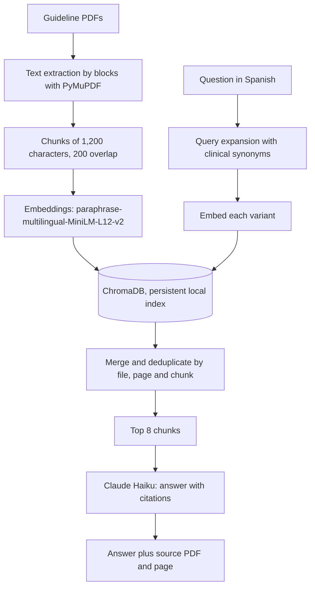

# clinical-guidelines-rag

Retrieval Augmented Generation (RAG) over 643 Mexican Clinical Practice Guidelines (Guías de Práctica Clínica, GPC). You ask a clinical question in Spanish and get a short answer written by Claude Haiku, grounded in the retrieved passages and cited with the source PDF and page.

It is a local demo: a FastAPI backend that also serves a one page web interface.

> **Not medical advice.** This is a technical demo. Answers are generated by a language model from retrieved text and can be incomplete or wrong. Do not use it for clinical decisions. Always consult the original guideline and a qualified professional.

## How it works



Indexing (`scripts/indexar.py`, run once):

1. Each PDF page is read with PyMuPDF as text blocks in reading order, which keeps tables and algorithms in a sensible order.
2. The text is split into chunks of 1,200 characters with 200 characters of overlap. Cuts prefer paragraph breaks.
3. Chunks are embedded with `sentence-transformers/paraphrase-multilingual-MiniLM-L12-v2` and stored in ChromaDB with their file, page and chunk number. The script can resume: PDFs already indexed are skipped.

Answering (`backend/main.py`):

1. The question is expanded into up to 4 variants using a small dictionary of clinical synonyms (treatment, diagnosis, symptoms, dose, prevention, complications, follow up). Only the first matching term is expanded.
2. Each variant is searched in ChromaDB (10 candidates each). Results are merged, deduplicated by file, page and chunk, sorted by distance, and the best 8 are kept.
3. The 8 chunks go to Claude Haiku with instructions to answer only from them, quote the supporting text and end with `[Fuente: PDF, p. X]`.
4. The API returns the answer plus the list of sources (PDF, page and a 300 character excerpt).

## Stack

* Python 3.13
* FastAPI and Uvicorn
* PyMuPDF for PDF extraction
* sentence-transformers for embeddings
* ChromaDB as the vector store
* Anthropic API (Claude Haiku, `claude-haiku-4-5` by default)
* A single HTML page with Vue 3 loaded from a CDN as the interface

## Numbers

Measured on the author's local index:

* 643 guidelines
* 1,285 PDFs
* 114,208 chunks in the `guias_medicas` collection

## Run it locally

Requirements: Python 3.13 and an Anthropic API key. The pinned `torch` version has no wheels for Python 3.14, so use 3.13.

```bash
git clone https://github.com/OscarJ290/clinical-guidelines-rag.git
cd clinical-guidelines-rag

python -m venv .venv
# Windows: .venv\Scripts\activate    macOS or Linux: source .venv/bin/activate
pip install -r requirements-dev.txt

cp .env.example .env      # Windows: copy .env.example .env
# edit .env and set ANTHROPIC_API_KEY
```

Put the guideline PDFs in `data/pdfs` (subfolders are fine), then build the index. This is the slow step, since every chunk is embedded on your machine.

```bash
python scripts/indexar.py
python scripts/probar_busqueda.py   # optional sanity check
```

Start the server and open http://localhost:8000:

```bash
uvicorn backend.main:app --port 8000
```

You can also call the API directly:

```bash
curl -X POST http://localhost:8000/preguntar \
  -H "Content-Type: application/json" \
  -d '{"texto": "¿Cuál es el tratamiento de la hipertensión arterial en el primer nivel de atención?"}'
```

Run the tests from the repo root:

```bash
pytest
```

Configuration lives in `.env` (see `.env.example`): `ANTHROPIC_API_KEY`, `CHROMA_DIR` (default `data/chroma_db`), `PDF_DIR` (default `data/pdfs`) and `HAIKU_MODEL` (default `claude-haiku-4-5`).

## Data source

The corpus is the set of public Clinical Practice Guidelines (Guías de Práctica Clínica, GPC) from the IMSS catalog. The PDFs and the vector index are **not included** in this repository. Download the guidelines yourself and build the index with the steps above.

## Limitations

* Local demo only. It has not been deployed or load tested.
* The content and the answers are in Spanish. Questions in other languages are not supported.
* No authentication, and CORS is open to any origin. Do not expose it to a network as is.
* Evaluation is minimal: one retrieval test (a hypertension query that must return IMSS-076-08-ER first). There is no benchmark of retrieval quality and no evaluation of answer correctness.
* Retrieval is semantic only. Some queries return loosely related passages, for example references sections that mention the topic.
* `scripts/indexar.py` asks ChromaDB for cosine distance, but the index the author measured this on reports L2 distances (values well above 2). If you need cosine, rebuild the index with a clean `CHROMA_DIR`.
* Answers depend on the retrieved chunks. When they are not enough, the model is instructed to say so, but it can still make mistakes.

## License

MIT. See [LICENSE](LICENSE).
